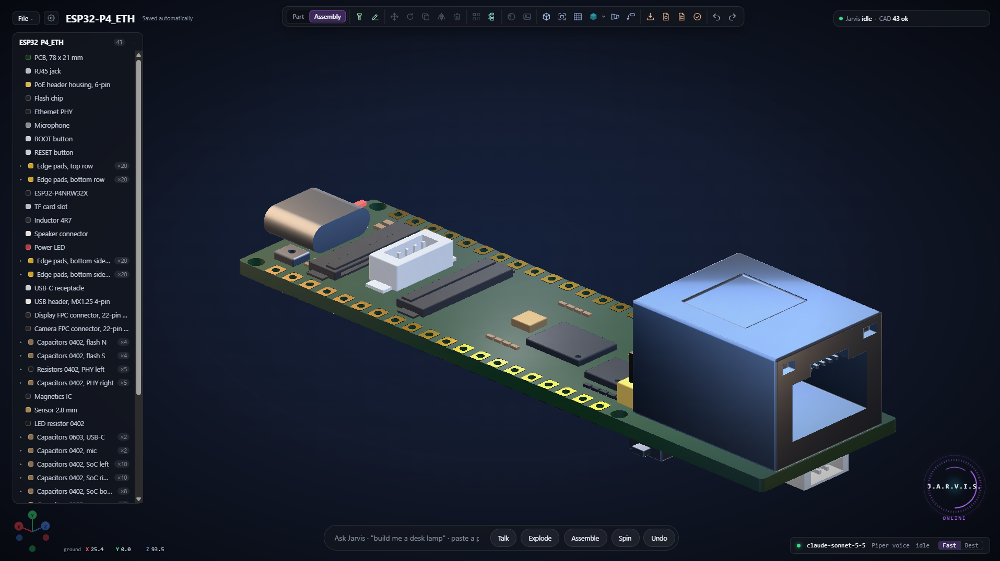

# Jarvis Studio

A local, single-user parametric CAD app with an AI assistant, Jarvis. The aim is a full professional CAD program,
with CAM later. It runs on your own machine: a web UI, a Node server and the OpenCascade kernel. There is no cloud
storage or computation.



Design notes are in [docs/ARCHITECTURE.md](docs/ARCHITECTURE.md). The order of work is in
[docs/ROADMAP.md](docs/ROADMAP.md).

## What it does

- **Sketches:** lines, arcs, circles, slots, splines, text and more, with relations and dimensions. Model edges can be
  turned into sketch items, and there is a trim tool (see [docs/SKETCH_TOOLS.md](docs/SKETCH_TOOLS.md)).
- **Features:**
  - from sketches: extrude, revolve, loft, sweep, hole and thread, each with the options a professional CAD program
    gives it;
  - applied to the body: fillet, chamfer, shell, draft, mirror and patterns.
- **Feature tree:** sketches sit under the features that use them, folders group steps, the Solid Bodies folder
  lists the bodies, and steps can be hidden, suppressed and reordered.
- **Tool forms:** open in the left panel in place of the tree, with see-through previews over the model.
- **Parts and assemblies:** several parts in one project. Mates are in progress.
- **Import:**
  - STEP, IGES, STL and .sldprt parts (read from the file's own Parasolid data);
  - feature histories exported from another CAD program with the macro in `tools/`, rebuilt as features.
- **Export:** STL, and a FreeCAD macro.
- **Options:** general, sketch, tool defaults, units, display, lighting, AI model, toolbars and files.
- **Jarvis:** type in the prompt bar, or hold **Talk** and speak. Jarvis uses the same tools as the UI.

What each tool has and still lacks is in [docs/FEATURE_OPTIONS.md](docs/FEATURE_OPTIONS.md).

## Requirements

- Node 22, Python 3 and ffmpeg.
- For Jarvis, either of these, chosen in Options > AI:
  - Claude Code installed and logged in on this machine (the default);
  - an Anthropic API key, which stays on the server and is never shown in full.

## Setup and run

```bash
npm install
npm run setup:voice   # Piper voice (speech out)
npm run setup:stt     # faster-whisper model (speech in)
npm run dev
```

Open http://localhost:4719. Esc stops Jarvis. Without the voice or speech setup the app still works: it falls back to
the browser's voice and hides the Talk button.

## Ports (all bound to 127.0.0.1)

| Port | What |
|---|---|
| 4719 | Web app (Vite), proxies `/api`, `/ws` and `/mcp` to the server |
| 4720 | Server: project store, CAD kernel, tools, Jarvis, MCP |
| 4721 | Piper text-to-speech |
| 4722 | Whisper speech-to-text |

## Driving it from another AI client

Every app action is an MCP tool, served over Streamable HTTP at `http://127.0.0.1:4720/mcp`. With Claude Code:

```bash
claude mcp add --transport http jarvis-studio http://127.0.0.1:4720/mcp
```

## Moving designs over from another CAD program

The history export macro in `tools/` runs inside the other program. You double-click it and choose a folder. It
writes a `<name>.jarvis-sw.json` next to every part and assembly in that folder and its subfolders. Import those files
with File > Import: parts come in with their features, sketches and folders, and assemblies with their components.
The macro's own README, next to it, has the details.

## Environment settings

| Variable | Default | Meaning |
|---|---|---|
| `JARVIS_MODEL` | `sonnet` | Claude model used for Jarvis in Fast mode |
| `JARVIS_EFFORT` | `medium` | Thinking effort in Fast mode (`low` is faster, `high` designs more carefully) |
| `JARVIS_QUALITY` | `fast` | Start in `best` mode (Opus, high effort); also switchable in the status chip |
| `JARVIS_STT_MODEL` | `base.en` | Whisper model |
| `JARVIS_PROJECTS_DIR` | `./projects` | Where projects and exports are saved |

The model and effort can also be set in Options > AI.

## Checks

```bash
npm run typecheck
npx vitest run
```

The test "makes a 10-turn spring along a helix, watertight and quickly" is timing-based and can fail on a busy machine;
run its file alone before treating it as a failure.
